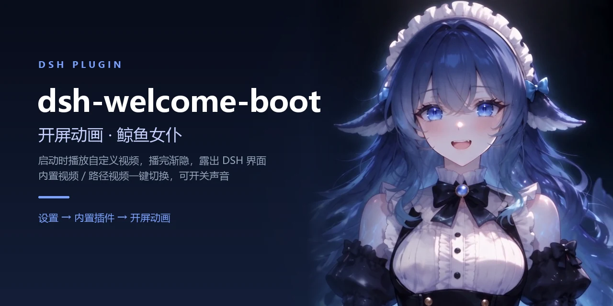

<h1 align="center">dsh-welcome-boot</h1>

<p align="center">
  <br>
  <sub>DSH 开屏动画插件 · 内置视频 / 路径视频 / 声音开关</sub>
</p>

<p align="center">
  <b>启动 DSH 默认播放鲸鱼女仆的开机动画，点「设置 → 内置插件 → 开屏动画」就可以换成自己的视频。</b>
</p>

---

## 特性

- **装上即用**：自带一段默认视频，安装后无需任何配置。
- **两种视频来源**：勾选「内置视频」播插件自带的那段；取消后播你填的路径。
- **声音可开关**：桌面端 Electron 默认允许有声自动播放，勾选框即时生效。
- **播完渐隐**：视频结束停留一帧，再淡出露出界面（默认 0.3 秒）。
- **可完全关闭**：取消「内置视频」且清空路径，插件不注册任何覆盖层，DSH 按未安装时启动。
- **格式宽松**：视频 `mp4 / m4v / webm / mov / mkv / ogv / ogm / mpg / mpeg / ts`，动图与静图 `gif / apng / webp / avif / png / jpg / jpeg / svg / bmp / ico`。
- **可拖动进度**：媒体通过支持 `Range` 的路由流式返回，大文件不会一次性读完。

## 安装

### 从 GitHub 安装

需要本机已安装 `git`（pnpm 解析 `github:` 依赖时会调用它）。

```bash
dsh plugin --profile <profile> add github:<你的用户名>/dsh-welcome-boot
```

也可以在 DSH 里让 agent 用 `plugin_manager` 的 `install_bundle`，target 填同一个 spec。

### 从本地目录安装

```bash
git clone https://github.com/<你的用户名>/dsh-welcome-boot.git
dsh plugin --profile <profile> add <本地绝对路径>
```

安装后**重启 DSH**（宿主半是 Node 模块，需要重新加载）。

## 使用

打开 **设置 → 内置插件 → 开屏动画**：

| 控件 | 作用 |
|---|---|
| 视频 / 动图路径 | 填绝对路径，或点「选择文件…」在原生文件对话框里挑 |
| 播放声音 | 勾选 = 有声，取消 = 静音（即时保存，不用点「保存」） |
| 内置视频 | 勾选 = 播插件自带的视频；取消 = 播上面的路径 |
| 保存 | 保存路径。路径无效会在页面上显示原因，不会静默失效 |
| 清除 | 清空路径。此时若仍勾着「内置视频」，继续播内置视频 |

两个勾选项**默认都是勾上的**。取消「内置视频」又没填路径时，插件完全不介入。

改动在**下次启动 DSH 或刷新页面**后生效——开屏只在页面加载时读一次配置。

## 配置

设置页写入的状态文件（优先级最高）：

```
$DSH_HOME/dsh-welcome-boot/config.json
```

```json
{
  "src": "C:\\Users\\me\\Videos\\opening.mp4",
  "muted": false,
  "builtin": true,
  "volume": 0.8
}
```

也可以在 profile 的 `cordis.patch.yml` 里覆盖整行 config（优先级次之，字段缺省回落到默认值）：

```yaml
- id: dsh-welcome-boot
  name: dsh-welcome-boot
  config:
    muted: false        # 播放声音
    volume: 1           # 0–1
    builtin: true       # 使用内置视频
    fit: cover          # cover 铺满裁切 / contain 完整显示 / fill 拉伸
    skip: button        # button 右下角按钮 / click 点任意位置 / auto / never
    fadeInMs: 320
    fadeOutMs: 300
    duration: 0         # 最长播放毫秒数，0 = 播完为止
    playbackRate: 1     # 0.1–4
```

字段写错只会退回默认值，不会导致启动失败。

## 工作原理

- **宿主半**（`index.js`）注册四条路由：

  | 路由 | 作用 |
  |---|---|
  | `GET /dsh-welcome-boot/config.json` | 返回生效配置与媒体描述 |
  | `POST /dsh-welcome-boot/config` | 保存 `src` / `muted` / `builtin` / `volume` 的任意子集 |
  | `POST /dsh-welcome-boot/pick` | 在宿主侧弹出原生文件对话框 |
  | `GET /dsh-welcome-boot/asset/<name>` | 流式返回当前配置的媒体，支持 `Range` |

- **界面半**（`client.js`）注册到两个槽位：`shell.overlay`（开屏覆盖层，仅在配置了可播媒体时注册）与 `settings.plugins.tab`（设置页）。
- 首帧之前用同步请求读取配置，避免「界面先闪一下再出现动画」。

## 目录结构

```
.
├─ index.js              宿主半：路由、配置读写、媒体解析
├─ client.js             界面半：开屏覆盖层 + 设置页
├─ cordis.patch.yml      bundle 挂载声明
├─ package.json          清单（dsh.bundle / dsh.client）
├─ icon.webp             插件图标（512×512）
├─ assets/
│  ├─ default.mp4        内置开屏视频
│  ├─ banner.webp        README 横幅
│  └─ icon-96.webp       README 小图标
├─ tools/
│  └─ pick-media-file.ps1  原生文件对话框（Windows）
├─ README.md
└─ LICENSE
```

## 兼容性

- DSH Desktop 与 `dsh web`（Web 界面）。
- Node.js >= 20。
- Windows 上「选择文件…」走 PowerShell + STA 的原生对话框；没有对话框的宿主会提示直接填路径。

## 致谢

本项目派生自 [KDDKBD/DeepSeek-splash-animation](https://github.com/KDDKBD/DeepSeek-splash-animation)（MIT）。在此之上做了重命名与若干本地修改：

- 新增「内置视频」开关与「播放声音」勾选框；
- 保存接口支持只提交部分字段（切换开关不会重写路径）；
- 默认值改为有声，内置视频替换为自有素材；
- 读取状态文件时容忍 UTF-8 BOM；
- 本机回环请求不受 Host/Origin 护栏影响（桌面版设置页需要）；
- 移除诊断日志。

## 许可

[MIT](LICENSE)。

`assets/default.mp4` 为自有素材，不在 MIT 覆盖范围内；`assets/banner.webp` 与 `icon.webp` 由同一素材制作。
